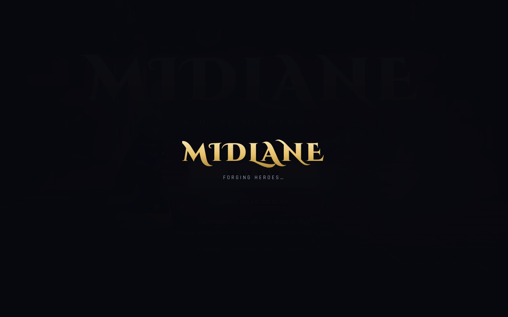
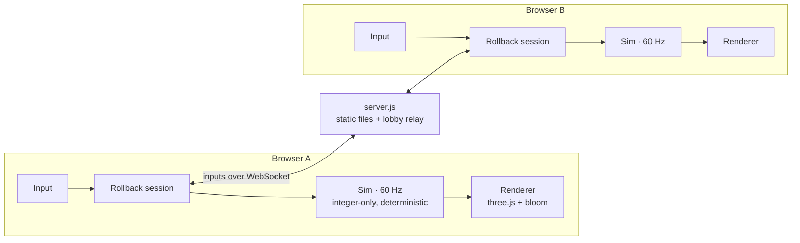

<div align="center">

# MIDLANE

**Six heroes. One lane. No mercy.**

[](https://howmuchcomputer.github.io/midlane/)
[](https://howmuchcomputer.github.io/midlane/download/MIDLANE-offline.zip)

**Nothing to install. Open the game and press Play now.**



A 2.5D fighting game for the browser where MOBA heroes settle things Street Fighter style.
Level up mid-fight, buy items between rounds, unleash your ultimate, and beat your friend over the LAN with rollback netcode.

[](https://github.com/howmuchcomputer/midlane/actions/workflows/ci.yml)


[](LICENSE)


</div>

---

## 🎮 Open it. Press Play now. Fight.

**[Play in your browser](https://howmuchcomputer.github.io/midlane/)** and click **Play now**. You jump straight into a match as Aldric against an Easy CPU on Riverbank. No mode, hero, arena, or shop screens to get through. A short countdown gives you a moment to get ready, and controls appear in the arena. Keyboard and gamepads work automatically.

Use **More ways to play** to choose your heroes, change difficulty, train, or play with a friend. Quick play uses its own simple rules; your custom match settings stay saved.

### Download and play offline

1. [Download the offline game](https://howmuchcomputer.github.io/midlane/download/MIDLANE-offline.zip).
2. Unzip it and open **MIDLANE.html** in your desktop browser.
3. Click **Play now**.

No Node.js, terminal, installation, or internet connection needed. Solo play, training, and two players on one computer all work in both the browser and offline editions. Playing on separate computers uses the LAN server edition below.

### LAN server and source code

For LAN battles or editing the game, install [Node.js](https://nodejs.org) 18 or newer, then [download the source](https://github.com/howmuchcomputer/midlane/archive/refs/heads/main.zip) and unzip it. Browser and offline players can skip this section.

Run these commands to start the LAN server and open your browser automatically. Keep the server window open while playing and press Control+C to stop it. No dependency install or build step is needed for the server.

```bash
git clone https://github.com/howmuchcomputer/midlane.git
cd midlane
npm start            # starts the server and opens your browser
```

```
  ⚔  MIDLANE server running

     Local:   http://localhost:7878
     LAN:     http://192.168.1.23:7878   (en0)
```

If your browser does not open, use the **Local** link printed in the window. For a server that doesn't open a browser, use `npm run serve` (or `node server.js`). `BROWSER=none npm start` and `node server.js --open --no-open` also suppress browser opening.

## 🤝 Beat up a friend (LAN)

1. Run the server on one machine.
2. You open the **Local** link; your friend opens the **LAN** link on their laptop (same Wi-Fi).
3. Both choose **More ways to play → LAN Battle**. One of you clicks **Host a lane**, the other clicks it in the list to join.
4. Pick heroes, the host picks the arena, and settle it.

Inputs travel over **GGPO-style rollback netcode**. Your own inputs apply instantly, your friend's are predicted, and any wrong guesses get quietly rewound and replayed. On home Wi-Fi it's usually 1 to 3 frames of rollback, so it feels like you're on the same couch. The small `ping · rb` readout under the timer shows how it's doing.

> **On a Mac?** The first time you run it, macOS asks if `node` can accept incoming connections. Click **Allow** or your friend will be shouting "it won't load" at you.
>
> **Port 7878 taken?** The server hops to the next free port and tells you. To pick one yourself: `PORT=8080 npm start`.

---

## ⚔️ The roster


| | Hero | Plays like | Ultimate |
|---|---|---|---|
| ☀️ | **Aldric**, the Sunforged | The all-rounder. Fireball, invincible uppercut, armoured charge. Learn him first. | **Heaven's Verdict** |
| 🌙 | **Ysolde**, the Duskblade | Rushdown menace. Low dashes, overhead flips, shadow clones that make you guess wrong. | **Thousand Shadows** |
| ⭐ | **Orren**, the Starwright | Space wizard zoner. Angled star bolts, a gravity well that drags you in, short teleport. | **Supernova Lance** |
| 🔨 | **Brakka**, the Iron Bastion | Walking fortress. Shrugs off hits, shockwaves the floor, and grabs you when you block. | **Colossus Slam** |
| ❄️ | **Kaida**, the Frostborn | Berserker with a very long axe. Ice waves, and she hits harder the more hurt she is. | **Frostquake** |
| 🌿 | **Wren**, the Thornwarden | Trapper. Long whip, root seeds, vaults over your head on a vine. | **Heartwood Colossus** |

Every hero has a passive, three abilities, an ultimate, a full set of normals, and a throw. Pause → **Move list** shows the whole kit with frame data.

### Four arenas

| | |
|---|---|
|  **Riverbank at Dusk** |  **Frostfang Summit** |
|  **The Molten Forge** |  **Astral Sanctum** |

---

## 🕹️ Controls

| Action | Keyboard | Gamepad |
|---|---|---|
| Move / jump / crouch | `W` `A` `S` `D` or arrows | Left stick / D-pad |
| Light · Medium · Heavy | `J` · `K` · `L` | X · Y · RB |
| Abilities Q · W · E | `U` · `I` · `O` | A · B · RT |
| **Ultimate** | `Space` | LB |
| Dash / Dispel / Rush | `Shift` (hold back to backdash) | LT |
| Throw | `J`+`K` or `H` | X+Y |
| Pause | `Esc` | Start |

- **Block** by holding away from your opponent. Crouch to block lows, stand to block overheads.
- **Two players, one keyboard:** P1 gets `WASD` + `F G H` / `R T Y` / `V` / `LShift`; P2 gets the arrows + `, . /` / `K L ;` / `'` / `RShift`. Two gamepads also work.
- Everything is rebindable in **Options**.

## 🧠 It's deeper than it looks


**The fighting game part**
- Light → Medium → Heavy **chains**, normals **cancel into abilities**, some abilities cancel into your **ultimate**.
- **Rush cancel:** dash out of a normal that connects (costs mana) to keep the pressure going.
- **Throws** beat blocking, strikes beat throws, and you can **tech** a throw by throwing right back.
- **Counter hits**, **punish counters**, juggles, combo scaling, invulnerable backdashes, reversals, quick rise.
- **Dispel:** dash while you're being comboed or blocking to blast the attacker away. Your get-out-of-jail card, paid for with mana.

**The MOBA part**
- **Mana and cooldowns** on every ability. Spam carefully.
- **Levels 1 to 6 inside a match.** Dealing and taking damage earns XP. Abilities rank up, and your **ultimate unlocks at level 4**.
- **Gold and items.** Earn gold from damage, combos and rounds (the loser gets comeback gold). Spend it in the **Strategy phase** and between rounds: 12 items, 4 slots.
- **Runes** spawn mid-round: Fury, Haste, Renewal, Insight, Fortune. Fight over them.


**Modes:** Versus CPU (Easy, Normal, Hard, Legend) · Local Versus · LAN Battle · Training (infinite mana, dummy settings, frame advantage readout, **hitbox overlay**).

---

## 🛠️ Build on it

Everything is plain ES modules served straight from `public/`. Edit a file, refresh the browser, done. All the models, animations, arenas, music and sound effects are generated in code, so there are no asset pipelines to fight.



The simulation is **integer-only and fully deterministic**: no floating-point positions, no `Math.random`, no clock. Two browsers given the same inputs land on the same state bit for bit, which is what makes rollback work. The renderer just draws whatever state the sim hands it.

```
server.js                  Zero-dependency HTTP server + WebSocket lobby/relay
public/index.html          Entry point (import map → vendored three.js)
public/src/sim/            The game: fighters, combat, items, runes, CPU AI   (deterministic!)
public/src/sim/heroes/     Hero kits: frame data, hitboxes, abilities, grabs
public/src/net/            Rollback session + WebSocket client
public/src/render/         three.js renderer: IK rig, cel shading, VFX, camera, post-processing
public/src/render/heroes/  Hero models, animation timelines, ability effects
public/src/render/stages/  The four arenas
public/src/audio/          Procedural sound effects + music sequencer
public/src/ui/             Menus, character select, lobby, HUD, shop
tools/                     Tests, soak tests, balance simulator
docs/HEROES.md             How to make your own hero
```

### Add your own hero

A hero is two files: a **sim** file (stats, frame data, hitboxes, abilities) and a **render** file (model, poses, effects). [`docs/HEROES.md`](docs/HEROES.md) walks through it, and Aldric is the reference implementation to copy. Register both in their folder's `index.js` and your hero shows up in character select. Fill in a few AI hints and the CPU can play them too, and because the sim is deterministic, LAN play just works.

### Tests and tools

```bash
npm install       # dev tools only (ESLint and Playwright); the game itself needs nothing
npm test          # determinism soak for all 36 matchups, rollback over a fake laggy network,
                  # CPU matches for every hero, and the LAN server + WebSocket lobby
npm run test:launch # browser opening, headless starts, and busy-port handling
npx playwright install chromium # one-time browser setup for development checks
npm run test:startup # one-button play, keyboard/gamepad input, rematches, and mode navigation
npm run build:web  # static site + the self-contained offline download in dist/
npm run test:pages # a /midlane/ static host and file:// play with networking disabled
npm run lint

node tools/balance.mjs 8 2                # CPU round-robin: win rates, match length, ult timing
node tools/simtest.mjs kaida wren 20000   # random-input soak + determinism check for one matchup
node tools/nettest.mjs orren brakka 6 6 2 # two rollback clients, 6±6 frames of lag, input delay 2
```

With the server running, there are dev pages too:

- `/dev/sandbox.html?p1=ysolde&p2=kaida&stage=forge`: a raw fight sandbox
- `/dev/poses.html?hero=brakka`: every animation as a contact sheet with hitboxes drawn on
- `/dev/stage.html?stage=astral`, `/dev/icons.html`, `/dev/audio.html`: arenas, icons, every sound

CI runs lint, game, launcher, browser, and offline-download checks on every push and pull request. Successful main-branch runs also publish the browser game and offline download to GitHub Pages.

### Publish the Play and Download buttons

A repository owner or maintainer enables this once:

1. Put these changes on the repository's `main` branch.
2. In **Settings → Pages → Build and deployment**, set **Source** to **GitHub Actions**.
3. Run **Actions → CI → Run workflow** on `main`, or push a new commit to `main`.

After the checks and deployment pass, the Play and Download buttons at the top of this page work for everyone. GitHub hosts the files; visitors only need a desktop browser. The workflow publishes `dist/`, including `download/MIDLANE-offline.zip`.

For a fork, update the two button URLs and the play/download links in this README to `https://YOUR-USERNAME.github.io/YOUR-REPOSITORY/`. The game itself supports repository subpaths and custom domains without path changes.

The browser and offline editions offer solo play, training, and Local Versus. GitHub Pages cannot run the LAN relay; that stays in the Node.js server edition.

### Ideas if you're looking for something to build

- A seventh hero (a summoner? a hook-thrower?)
- Online play beyond the LAN (the relay is tiny, it just needs hosting)
- Replays. The sim is deterministic, so a replay is just the seed plus the input log.
- A spectator mode, an arcade ladder, or a tournament bracket for game night

---

## 🩹 Troubleshooting

- **Friend can't connect:** they need the **LAN** address, not `localhost`. Check you're on the same network and that the macOS firewall let `node` through. Some guest and office networks block device-to-device traffic.
- **Choppy frame rate:** Options → Graphics → Performance, then reload.
- **No sound:** browsers only start audio after you interact, so click **Play now** or **More ways to play**.

## 📜 License

[MIT](LICENSE). Go wild.

All heroes, arenas and code are original. Bundled third-party bits: [three.js](https://threejs.org) (MIT, see `public/vendor/three/LICENSE`) and the Cinzel, Cinzel Decorative and Rajdhani fonts (SIL Open Font License, see `public/vendor/fonts/LICENSE-OFL.txt`).
